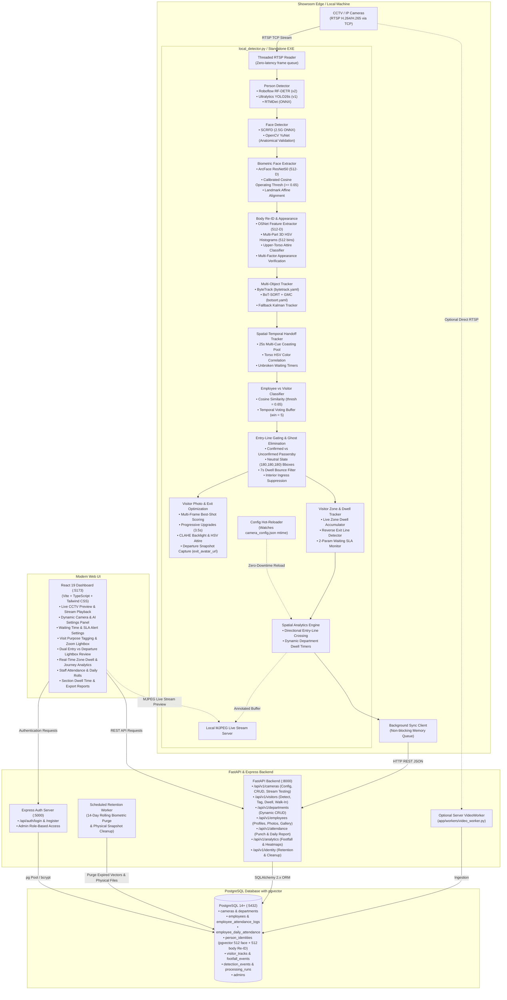
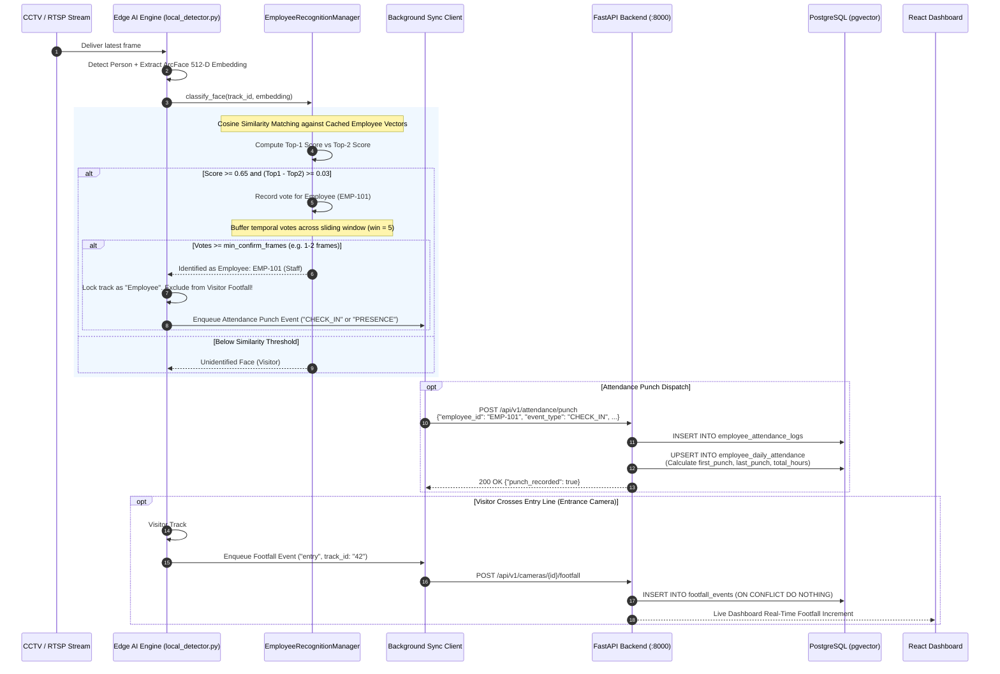
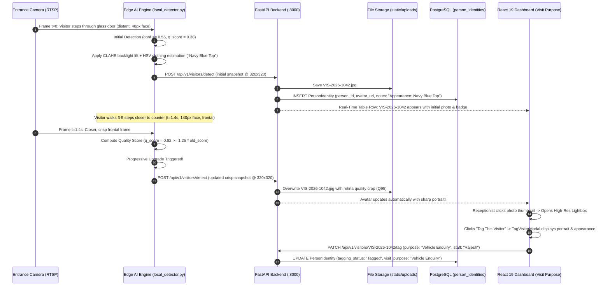
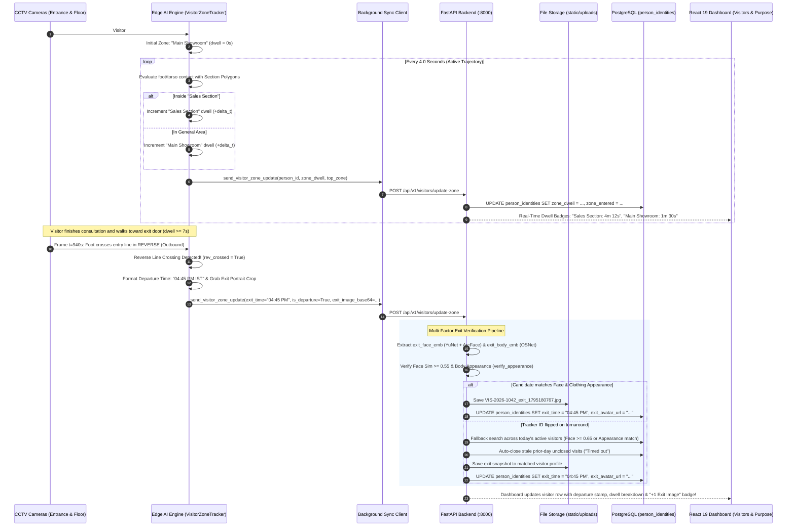
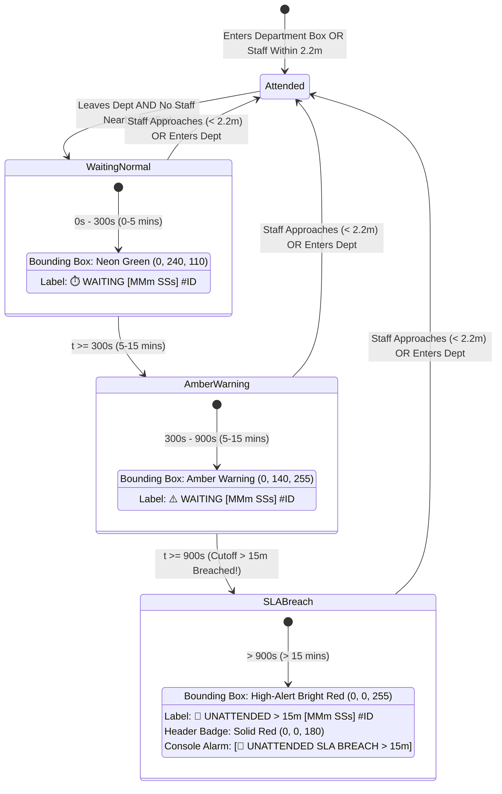
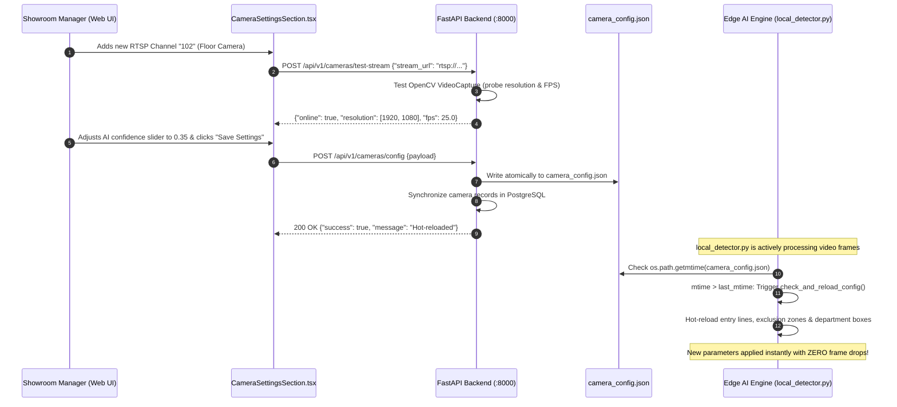
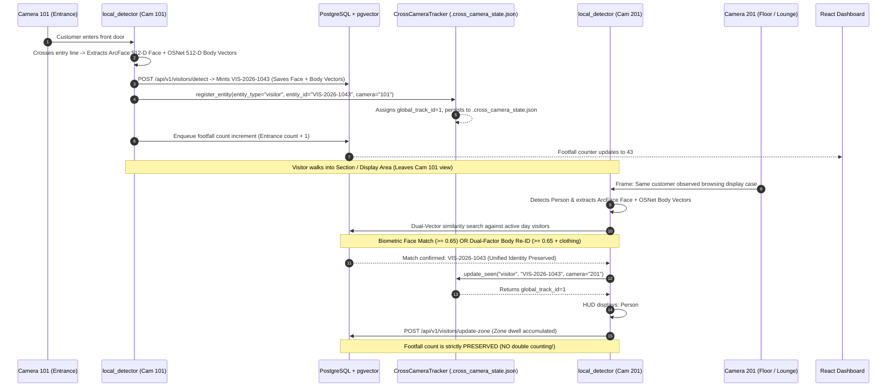
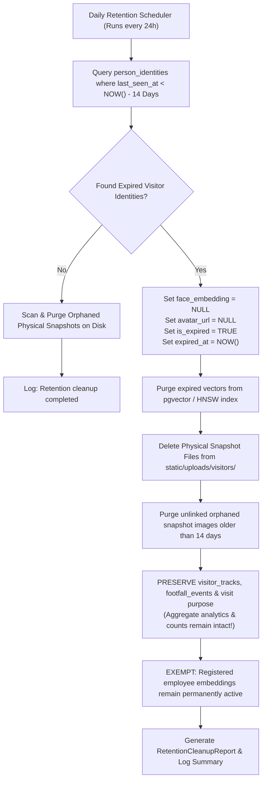
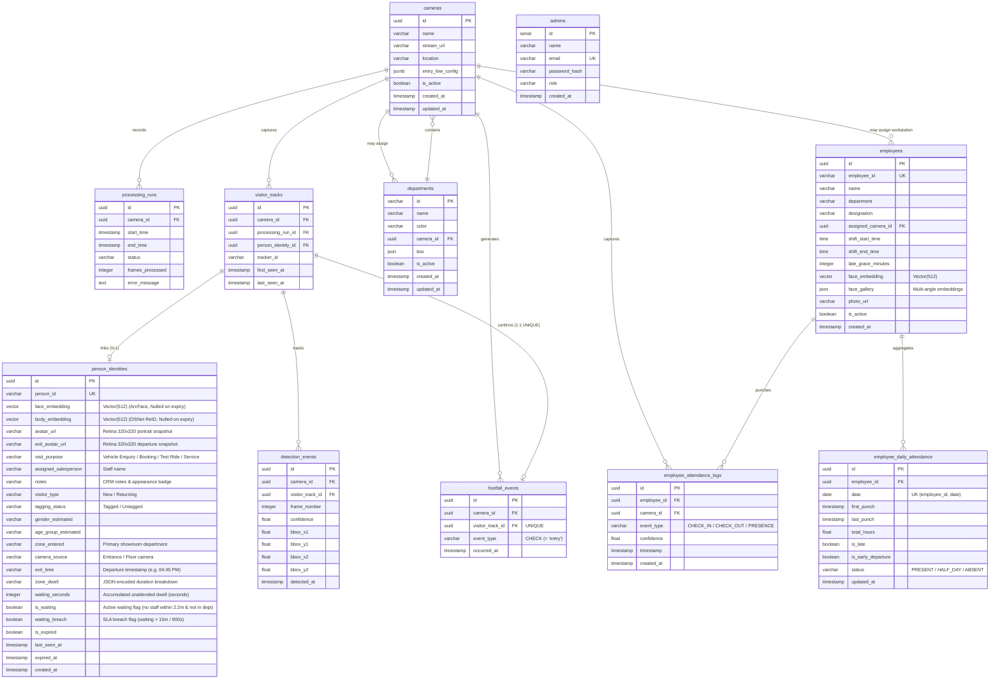

# Showroom Visitor Intelligence (JMS) — Architecture & Data Flow Specification

This document details the end-to-end system architecture, operational data flows, communication protocols, computer vision algorithms, biometric matching pipelines, and database schemas powering the **Showroom Visitor Intelligence & Footfall Analytics** platform.

---

## 1. High-Level Architecture Overview

The system is engineered as an **Edge-AI Hybrid Architecture**. Computationally intensive deep-learning inference (object detection, multi-object tracking, neural face detection, biometric embedding extraction, photo quality scoring, and zone dwell computation) runs locally at the showroom edge near the camera network. Analytics aggregation, visitor CRM tagging, dynamic camera configuration, employee management, session authentication, and data retention run on a centralized backend and modern web dashboard.



---

## 2. Core Computer Vision & Biometric Pipeline

### 2.1 RTSP Stream Ingestion & Non-Blocking Draining
* **TCP Transport (`rtsp_transport;tcp`)**: UDP RTSP feeds drop packets over congested LANs, creating H.264 macroblock corruption and frozen frames. The system globally enforces TCP via OpenCV FFmpeg flags.
* **Threaded Frame Draining (`ThreadedRTSPReader`)**: Standard OpenCV `cv2.VideoCapture` maintains an internal multi-frame decode buffer. If deep inference takes 30ms, frames queue up and create massive lag. `ThreadedRTSPReader` spawns a dedicated daemon thread running `grab()` continuously, storing solely the latest decoded frame. Latency from physical camera lens to inference input is kept under **30–50ms**.

### 2.2 Multi-Model Person Detection Architecture
The edge engine supports dynamic runtime switching across detection backends:
1. **Roboflow RF-DETR (`--v2`)**: Real-Time Detection Transformer with DINOv2 self-supervised visual backbone. Delivers unmatched precision in crowded environments, eliminating false merges and detecting seated, partially occluded, or distant persons.
2. **Ultralytics YOLO (`--v1`)**: Ultra-fast convolutional detection engine (defaults to `models/yolo26s.pt`). Provides rapid inference (15–30ms per frame on modern GPUs or 50–70ms on modern multi-core CPUs).
3. **RTMDet Support**: ONNX runtime engine optimized for high-throughput edge devices.

Inference input resolution defaults to `960x960` or `1024x1024` pixels (`--imgsz 960`), ensuring small faces and distant visitors entering through showroom glass doorways are detected reliably.

### 2.3 Neural Face Detection & Quality Gating
Face detection operates under a hierarchical upper-torso spatial constraint and multi-stage anatomical quality verification:
* **Detector Models**: SCRFD (`scrfd_2.5g_bnkps.onnx`) or OpenCV YuNet (`face_detection_yunet_2023mar.onnx`).
* **Spatial Alignment**: Face boxes are strictly validated within the top 35% of the person's bounding box. This prevents false face triggers from clothing graphics, catalog prints, or posters.
* **Biometric Quality & Anatomical Filters**:
  * **Face Blur Filtering**: Laplacian variance must exceed `FACE_BLUR_THRESHOLD = 5.0` to reject fast-motion blur.
  * **Head Pose Limits**: Maximum yaw $\le 65^\circ$, pitch $\le 50^\circ$, and roll $\le 40^\circ$ (specifically accommodating $35^\circ$–$45^\circ$ overhead CCTV angles).
  * **Inter-Ocular Distance**: Minimum eye distance $\ge 2.5$ pixels to reject unresolvable distant faces.
  * **Illumination Gating**: Mean grayscale illumination between 18.0 and 245.0 to filter extreme backlight silhouettes or lens glare.
  * **Anatomical Bounding Box Constraints (YuNet `detect_and_crop_face`)**:
    - Minimum face dimensions: $w \ge 16\text{ px}$, $h \ge 18\text{ px}$ with confidence threshold $\ge 0.40$ (score threshold $0.35$).
    - Maximum face proportion: Face box cannot occupy $> 75\%$ of crop width or $> 65\%$ of crop height.
    - Aspect ratio check: $0.45 \le \frac{w}{h} \le 1.55$.
    - **Upper-Body Anatomical Restriction**: For standing person crops ($h > w \times 1.15$), the vertical face center must satisfy $c_y \le 0.50 \cdot h$. This rigorously rejects false face triggers on circular floor items such as waste bins, shoe heels, or floor bag buckles.

### 2.4 ArcFace Biometric Feature Extraction
For validated faces:
* **Canonical 5-Point Alignment**: Faces are geometrically aligned to canonical $112 \times 112$ ArcFace reference landmarks using affine similarity transformation.
* **Deep Feature Representation**: Passing through ArcFace ResNet50 (`models/w600k_r50.onnx`) outputs a 512-dimensional feature vector.
* **L2-Normalization**: Feature vectors are L2-normalized:
  $$\mathbf{e} = \frac{\mathbf{v}}{\|\mathbf{v}\|_2}, \quad \|\mathbf{e}\|_2 = 1.0$$
* **Distance Metric**: Similarity between two face embeddings $\mathbf{e}_1, \mathbf{e}_2$ is calculated as dot-product cosine similarity:
  $$\text{CosineSimilarity}(\mathbf{e}_1, \mathbf{e}_2) = \mathbf{e}_1 \cdot \mathbf{e}_2$$
* **Calibrated Operating Thresholds**:
  - Staff / Visitor Matching Threshold: Calibrated operating threshold **$\ge 0.65$** (`FACE_SIMILARITY_THRESHOLD = 0.65`) providing high biometric precision.
  - Candidate Match Margin: Minimum margin between Top-1 and Top-2 candidate matches $\ge 0.030$.

### 2.5 Deep Full-Body Re-Identification & Multi-Part Appearance Modeling (`BodyEmbedder`)
In overhead showroom CCTV feeds, visitors frequently turn 180° away from the entrance, bend over jewelry showcases, or wear hats/masks where facial biometrics are temporarily unavailable. The system deploys `BodyEmbedder` for deep full-body Re-ID combined with multi-part 3D color histograms:

1. **OSNet Feature Extraction**:
   - Built on Omni-Scale Network (`osnet_x1_0` or `osnet_x0_25` ONNX/PyTorch models).
   - Generates a **512-dimensional L2-normalized deep appearance vector** capturing multi-scale bodily features and clothing patterns.
2. **Multi-Part 3D HSV Color Histograms**:
   - Rather than simple 1D hue histograms, extracts full 3D joint Hue-Saturation-Value histograms ($8 \times 8 \times 8 = 512\text{ bins}$) normalized via L1-norm ($\|\mathbf{h}\|_1 = 1.0$).
   - **Upper-Torso Region**: $y \in [0.22, 0.52]$, with $30\%$ horizontal insets ($x \in [0.30, 0.70]$) to cleanly isolate shirts/tops and eliminate background walls, door frames, or laminate flooring.
   - **Lower-Body / Legs Region**: $y \in [0.55, 0.90]$, with $30\%$ horizontal insets.
   - **Composite Clothing Similarity**:
     $$\text{clothing\_sim} = \begin{cases} 
     0.65 \cdot \text{torso\_sim} + 0.35 \cdot \text{legs\_sim}, & \text{if } \text{torso\_sim} \ge 0.20 \text{ and } \text{legs\_sim} > 0.0 \\
     \text{torso\_sim}, & \text{if } \text{torso\_sim} \ge 0.20 \\
     0.0, & \text{otherwise (unmatching shirt rejects clothing match)}
     \end{cases}$$
3. **Upper-Torso Attire Classification (`estimate_clothing_appearance`)**:
   - Isolates central chest fabric ($y \in [0.24, 0.52]$, $x \in [0.30, 0.70]$).
   - **Chromatic vs Achromatic Gating**: Evaluates chromatic saturation ($S \ge 35, V \ge 45$). Chromatic classification requires $\ge 25\%$ chromatic pixels and mean saturation $\ge 26$, rejecting dark/black shirts with tiny wood frame reflections.
   - Classifies into high-contrast human-readable badges (*Red / Maroon Top*, *Orange / Rust Top*, *Yellow / Mustard Top*, *Green Top*, *Blue / Navy Top*, *Purple / Violet Top*, *Black / Dark Attire*, *White / Light Shirt*, *Gray Attire*, *Cream / Khaki Shirt*).
4. **Multi-Factor Appearance Verification Matrix (`verify_appearance`)**:
   - Prevents false Re-ID merges when static doorway backgrounds artificially inflate OSNet embeddings:
     - **Hard Contrast Conflict**: Instantly rejects matches between chromatic and achromatic garments (e.g. Red vs Black, Black vs White, Black vs Cream).
     - **Direct Torso Luminance Verification**: Rejects matches if median torso luminance difference $|V_1 - V_2| > 65.0$.
     - **Calibrated Multi-Factor Decision**:
       - Strict floor: Under no circumstances may `is_match` be True if $\text{clothing\_sim} < 0.36$ or $\text{torso\_sim} < 0.22$.
       - Identical confirmed attire tags: Requires $\text{ReID} \ge 0.70$ and $\text{clothing\_sim} \ge 0.36$.
       - High Re-ID confidence: Requires $\text{ReID} \ge 0.75$, $\text{clothing\_sim} \ge 0.36$, and $\text{torso\_sim} \ge 0.28$.
       - Moderate Re-ID confidence: Requires $\text{ReID} \ge 0.68$, $\text{clothing\_sim} \ge 0.48$, and $\text{torso\_sim} \ge 0.35$.

---

## 3. Employee Recognition & Automated Attendance Flow



### 3.1 Multi-Frame Voting Buffer Guarantee
To guarantee zero false positives (ensuring a visitor is never mistakenly tagged as an employee):
1. **Calibrated Threshold**: Baseline cosine similarity requires $\ge 0.65$ (calibrated for high precision ArcFace biometric discrimination).
2. **Top-1 vs Top-2 Match Margin**: The gap between the best match and second-best candidate from a different employee must be $\ge 0.030$.
3. **Temporal Voting Buffer**: Successive observations over `EMPLOYEE_VOTE_WINDOW` frames must vote for the same employee identity before the track is tagged as staff. Once confirmed, the employee ID is bound to that track for its duration.

### 3.2 Daily Attendance Roll Computation
When punches are ingested:
* **First Seen**: Sets `first_punch` for the day. If `first_punch > shift_start_time + late_grace_minutes`, `is_late` flag is set to `True`.
* **Last Seen**: Progressively updates `last_punch`.
* **Working Hours**: Total work duration is continuously calculated:
  $$\text{WorkDuration} = \text{last\_punch} - \text{first\_punch}$$
* **Early Departure**: If last punch is before `shift_end_time - early_departure_grace_minutes`, `is_early_departure` flag is recorded.

---

## 4. Multi-Object Tracking & Motion Stabilization

### 4.1 Pluggable Trackers
The system provides two production tracker configurations:
* **ByteTrack (`bytetrack.yaml`)**:
  - Associates both high-confidence ($> 0.20$) and low-confidence ($> 0.10$) detection boxes across frames.
  - Maintains lost tracks for up to `track_buffer: 150` frames (~5–7 seconds), bridging temporary occlusions when visitors walk behind showroom display cases or pillars.
* **BoT-SORT (`botsort.yaml`)**:
  - Extends tracking with **Global Motion Compensation (GMC)** via sparse optical flow (`sparseOptFlow`).
  - Mitigates false track drift caused by camera pole vibration, wind sway, or manual PTZ adjustments.
  - Tracks direct bounding box width and height states $(x, y, w, h)$ for improved tracking across seated-to-standing posture shifts.

### 4.2 Track Smoothing & Jitter Deadband
Raw detections exhibit coordinate micro-jitter due to digital sensor noise. The edge engine applies:
* **Exponential Moving Average (EMA)** smoothing:
  $$\text{Box}_{t} = \alpha \cdot \text{Box}_{\text{detected}} + (1 - \alpha) \cdot \text{Box}_{t-1}, \quad \text{with } \alpha = 0.35$$
* **Stationary Deadband Filter**: Shifts smaller than `deadband = 6.0` pixels are suppressed, locking bounding boxes motionless when persons stand still.

### 4.3 Multi-Cue Spatial-Temporal & Torso Handoff Tracking (`SpatialTemporalHandoffTracker`)
Showroom environments frequently present tracking interruptions: visitors turn 180° away from the lens, bend down over glass display cases, or are occluded by structural pillars. Under conventional tracking, such events cause raw tracker IDs to reset, which resets dwell timers, fragments visitor profiles, and duplicates records. 

`SpatialTemporalHandoffTracker` solves this through a multi-cue appearance coasting engine:
1. **25-Second Coasting Pool**:
   When a track disappears from the active frame, its state (last bounding box, upper-torso HSV histogram, `person_id`, display alias, `first_seen_ts`, `waiting_seconds`, and `waiting_breach` flag) is moved to a coasting pool for up to $25.0\text{ seconds}$ (`max_coasting_sec = 25.0`).
2. **Upper-Torso HSV Color Histogram Extraction**:
   For each tracked person, an adaptive upper-torso region (from $20\%$ to $58\%$ of total box height, with $15\%$ horizontal margin) is extracted and converted to HSV color space. A 2D joint Hue-Saturation histogram (16 hue bins $\times$ 8 saturation bins) is calculated and L1-normalized:
   $$H(h, s) = \frac{\text{Hist}(h, s)}{\sum \text{Hist}(h, s)}$$
3. **Multi-Cue Candidate Matching**:
   When a new track ID appears, it is matched against the coasting pool using a composite criterion:
   - **Normalized Spatial Proximity**: Center displacement normalized by maximum box height:
     $$\text{norm\_dist} = \frac{\sqrt{(x_{\text{new}} - x_{\text{coast}})^2 + (y_{\text{new}} - y_{\text{coast}})^2}}{\max(h_{\text{new}}, h_{\text{coast}})} \le 1.6$$
   - **Bounding Box Scale Consistency**: Area ratio $\frac{\text{Area}_{\text{new}}}{\text{Area}_{\text{coast}}} \in [0.45, 2.2]$ ensures matches are posture-compatible.
   - **Torso Color Histogram Correlation**: Evaluated via Pearson correlation coefficient:
     $$\text{Corr}(H_{\text{new}}, H_{\text{coast}}) = \frac{\sum_i (H_{\text{new}}(i) - \bar{H}_{\text{new}})(H_{\text{coast}}(i) - \bar{H}_{\text{coast}})}{\sqrt{\sum_i (H_{\text{new}}(i) - \bar{H}_{\text{new}})^2 \sum_i (H_{\text{coast}}(i) - \bar{H}_{\text{coast}})^2}} \ge 0.55$$
4. **Seamless Identity & Timer Restoration**:
   When a match satisfies $\text{Corr} \ge 0.55$ within proximity limits, the new track inherits the original visitor metadata:
   $$\text{first\_seen\_ts}_{\text{new}} = \text{first\_seen\_ts}_{\text{coast}}$$
   $$\text{waiting\_seconds}_{\text{new}} = \text{waiting\_seconds}_{\text{coast}}, \quad \text{waiting\_breach}_{\text{new}} = \text{waiting\_breach}_{\text{coast}}$$
   $$\text{person\_id}_{\text{new}} = \text{person\_id}_{\text{coast}}, \quad \text{display\_id}_{\text{new}} = \text{display\_id}_{\text{coast}}$$
   This guarantees unbroken dwell accumulation, uninterrupted SLA monitoring, and zero duplicate customer records.

---

## 5. Visitor Photo Optimization & Purpose Tagging Pipeline

To ensure high-quality identification for showroom floor staff and front-desk receptionists tagging walk-in customers, the system employs an intelligent, multi-stage photo capture and progressive upgrade engine.



### 5.1 Multi-Frame Best-Shot Quality Scoring
Rather than committing to the very first frame where a face is detected (which is typically far away, motion-blurred, or looking sideways at the entrance door), the edge engine continuously scores every frame using a composite metric:

$$Q = 0.35 \cdot S_{\text{sharpness}} + 0.25 \cdot S_{\text{resolution}} + 0.20 \cdot S_{\text{pose}} + 0.10 \cdot S_{\text{illumination}} + 0.10 \cdot S_{\text{confidence}}$$

1. **Sharpness ($S_{\text{sharpness}}$)**: Evaluated via Laplacian variance $\sigma^2(\nabla^2 I)$ over the face crop. Frames with walking motion blur get low scores; crisp, stabilized frames receive maximum weight.
2. **Resolution ($S_{\text{resolution}}$)**: Scaled by face area relative to canonical $120 \times 120\text{ px}$. Denser crops with clear biometric features are heavily prioritized.
3. **Frontality & Pose Symmetry ($S_{\text{pose}}$)**: Evaluates roll tilt angle via eye landmarks ($\text{atan2}(\Delta y, \Delta x)$) and yaw offset from nose-to-eye horizontal center. Frontal poses receive scores close to $1.0$.
4. **Illumination Balance ($S_{\text{illumination}}$)**: Penalizes severe silhouettes ($\text{mean lum} < 85$) and camera lens glare ($\text{mean lum} > 175$).

### 5.2 Dynamic Progressive Upgrade Policy
* **Zero-Latency Ingress**: The first valid face observation is dispatched immediately to the dashboard to avoid any delay in displaying new walk-ins.
* **3.5-Second Walk-In Window**: During the visitor's first 3.5 seconds of trajectory, any frame with $Q \ge 1.25 \cdot Q_{\text{best}}$ (or $Q \ge Q_{\text{best}} + 0.15$) with at least $500\text{ ms}$ separation triggers a seamless progressive photo upgrade.

### 5.3 Contextual Bust Framing & CLAHE Backlight Compensation
* **Bust & Torso Framing**: To enable floor staff to instantly recognize customers from a distance, portrait crops extend beyond the face boundary:
  $$\text{Top} = y_1 - 0.45 \cdot f_h, \quad \text{Bottom} = y_2 + 0.85 \cdot f_h, \quad \text{Sides} = x_{1,2} \pm 0.40 \cdot f_w$$
  This captures hairstyle, collar, neck, and upper-chest attire.
* **CLAHE Equalization**: High dynamic range backlighting from showroom glass facades is corrected in LAB color space by applying Contrast Limited Adaptive Histogram Equalization (`clipLimit = 2.2`, `tileGridSize = 8x8`) exclusively to the luminance ($L$) channel, lifting facial shadows without bleaching background highlights.
* **Retina Standard**: Snapshots are standardized to $320 \times 320\text{ px}$ with Lanczos4 interpolation (`cv2.INTER_LANCZOS4`) and encoded at JPEG quality 95.

### 5.4 Torso HSV Attire Classification
The upper-torso region ($22\%$ to $60\%$ of total body height) is sampled in HSV color space to classify dominant attire colors (e.g. *Blue / Navy Top*, *White / Light Shirt*, *Red / Maroon Top*, *Black Attire*). This clothing tag is passed into the visitor record and rendered as a visual badge in the dashboard for instant customer association.

### 5.5 Departure Snapshot Capture & Dual-Photo Lightbox UX
When a visitor completes their visit and crosses the entrance line in reverse (with confirmed showroom dwell $\ge 7.0\text{s}$):
* **High-Resolution Exit Capture**: The edge engine grabs an un-annotated high-resolution portrait crop of the departing person and dispatches it via `exit_image_base64` in the departure update payload.
* **Biometric & Appearance Validation**: The backend extracts facial and body embeddings from the exit crop, verifying identity ($\ge 0.55$ face cosine similarity and multi-factor appearance match via `BodyEmbedder.verify_appearance`).
* **Storage & Persistence**: Saved to `static/uploads/visitors/` as `VIS-..._exit_<timestamp>.jpg` and stored in `person_identities.exit_avatar_url`.
* **Dashboard Dual-Photo Lightbox**: In `VisitorsView.tsx`, visitor cards display a **"+1 Exit Image"** badge. Clicking the photo opens an interactive high-resolution modal with **Entry Snapshot** and **Departure Snapshot** toggle tabs, enabling management to visually verify customer arrival and departure attire and context side-by-side.

---

## 6. Real-Time Visitor Journey, Zone Dwell & Exit Tracking

Beyond basic ingress counts, modern showroom management demands full visibility into customer browsing patterns, department-level interest, and total visit durations. The system implements a dedicated, non-blocking **`VisitorZoneTracker`** to monitor customer dwell and capture departure events in Indian Standard Time (IST, UTC+05:30).



### 6.1 Dwell Accumulation & Duration Formatting
* **Dynamic Dwell Bucketing**: For every active track, time spent inside each calibrated department polygon is accumulated. Time spent outside specific polygons is assigned to `"Main Showroom"`.
* **Human-Readable Formatter**: Dwell seconds are formatted into concise strings:
  $$\text{format\_duration}(s) = \begin{cases} 
  \text{Xs}, & s < 60 \\
  \text{Y mins}, & s \ge 60 \text{ and } s \pmod{60} = 0 \\
  \text{Ym Zs}, & s \ge 60 \text{ and } s \pmod{60} \ne 0
  \end{cases}$$
* **Periodic Synchronization**: The edge client bundles the dwell breakdown and flushes updates every `sync_interval = 4.0` seconds to `/api/v1/visitors/update-zone`.

### 6.2 Reverse Line Crossing, Premature Exit Suppression & Departure Verification
* **Directional Reversal**: An entrance line configured for ingress (`direction = "top_to_bottom"`) monitors the opposing cross-product trajectory ($y_{\text{curr}} < y_{\text{prev}}$ or reverse vector orientation).
* **7.0-Second Premature Exit Suppression**:
  To eliminate tracker noise, doorway turnarounds, or delivery people pacing at the threshold from triggering premature exits, `record_visitor_exit` enforces a minimum physical dwell threshold ($\text{dwell} \ge 7.0\text{ seconds}$). If reverse crossing fires with dwell $< 7.0\text{s}$, the exit update is suppressed and not dispatched to the backend.
* **Multi-Factor Departure Verification**:
  When departure update is dispatched with `exit_image_base64`, the backend validates the exit crop:
  - If a face is detected in the exit crop, cosine similarity with the candidate visitor must be $\ge 0.55$.
  - If a full-body crop is available, `BodyEmbedder.verify_appearance` validates OSNet Re-ID and clothing color consistency.
  - If appearance contradicts (e.g. different clothing colors), the exit is rejected, preventing accidental attachment of departure timestamps to wrong visitors.
* **Turnaround Fallback Search & Stale Record Auto-Closure**:
  If tracker ID flipped on a 180° exit turnaround (e.g. #2 became #6):
  - Stale unclosed visitor records from prior calendar days are automatically closed (`exit_time = "Timed out"`, `is_expired = True`) to prevent contamination.
  - Active candidates from today are searched using biometric face matching ($\ge 0.65$ with top-margin check) and/or body appearance consistency.
* **Indian Standard Time (IST) Clock**: When reverse crossing is confirmed, the departure timestamp is calculated in `Asia/Kolkata` time (`UTC+05:30`) and recorded:
  ```python
  exit_time = datetime.fromtimestamp(now_ts, tz=IST).strftime("%I:%M %p")
  ```
* **Bounced Visitor Removal Endpoint (`DELETE /api/v1/visitors/{person_id}`)**:
  If a visitor record needs to be removed (e.g. bounce cancellation or mistaken manual tag), the endpoint completely removes the `person_identities` record, linked `footfall_events`, `detection_events`, and unlinks image snapshots from disk.
* **Summary Telemetry**: The final zone dwell breakdown is emitted to system logs and persisted to the visitor's database record.

### 6.3 Staff Proximity Detection & Ground-Plane Proximity Engine
To distinguish whether a browsing customer is receiving assistance or waiting unattended, the edge vision pipeline computes real-time ground-plane spatial proximity between visitors and showroom staff (`is_staff_near_box`):
1. **Perspective-Calibrated Ground Contact**:
   The feet contact points of the visitor $(x_v, y_v)$ and employee $(x_s, y_s)$ are extracted from bottom-center coordinates:
   $$\mathbf{P}_{\text{feet}} = \left( \frac{x_1 + x_2}{2}, \; y_2 \right)$$
2. **Perspective Pixel-to-Meter Scaling**:
   Because camera perspective distorts pixel distances depending on distance from the lens, average bounding box height $\bar{h} = \frac{h_v + h_s}{2}$ serves as an adaptive reference scale calibrated to a standard human height ($1.70\text{ m}$):
   $$\text{Scale}_{\text{px/m}} = \max\left(1.0, \; \frac{\bar{h}}{1.70}\right)$$
3. **Proximity Radius Gating**:
   Euclidean ground distance in meters is calculated:
   $$d_m = \frac{\sqrt{(x_v - x_s)^2 + (y_v - y_s)^2}}{\text{Scale}_{\text{px/m}}}$$
   If $d_m \le \text{radius\_m}$ (default $2.2\text{ m}$), the visitor is marked as actively engaged (`is_employee_nearby = True`).

### 6.4 Visitor Waiting Timer & Configurable SLA Breach Pipeline
Showroom customer experience hinges on prompt staff engagement. The platform implements a strict **2-Parameter Unattended Waiting Logic** evaluated every frame:

$$\text{is\_waiting\_now} = (\neg \text{is\_employee\_nearby}) \land (\neg \text{is\_in\_dept})$$

* **Condition 1**: No registered employee is within the $2.2\text{ m}$ perspective radius.
* **Condition 2**: The visitor has not entered any designated department counter box (e.g., Sales Section, Consultation Desk).

When both conditions hold true, `waiting_seconds` accumulates continuously.



* **Three-Tier Visual HUD Alerts**:
  1. **Normal Waiting ($< 5\text{ mins}$)**: Neon Emerald Green bounding box `(0, 240, 110)` with `⏱️ WAITING [MMm SSs]` timer.
  2. **Elevated Warning ($5\text{ to }15\text{ mins}$)**: High-contrast Amber border `(0, 140, 255)` with `⚠️ WAITING [MMm SSs]` warning.
  3. **Critical SLA Breach ($> 15\text{ mins}$ / $900\text{s}$)**: Bright Red alert box `(0, 0, 255, thickness=3)` and red header badge `🚨 UNATTENDED > 15m [MMm SSs]`.
* **Monotonic Dwell Protection & Physical Elapsed Bounds**:
  - The backend `VisitorService.update_visitor_zone` enforces monotonic protection:
    $$\text{rec.waiting\_seconds} = \max(\text{rec.waiting\_seconds}, \; \text{req.waiting\_seconds})$$
    preventing any secondary camera or fresh track from rolling back waiting counts.
  - The edge engine enforces real physical dwell limits:
    $$\text{waiting\_seconds} \le \max(0.0, \; \text{now\_ts} - \text{first\_seen\_ts})$$
    guaranteeing that waiting timers cannot exceed physical time elapsed in the showroom.
* **Configurable SLA Cutoff**:
  The cutoff threshold is fully configurable in the React Dashboard ("Waiting Time & SLA Alerts" tab in Settings) and stored in `camera_config.json` (`waiting_cutoff_seconds`, default $900\text{s}$ / $15\text{ mins}$).
* **High-Resolution SLA Breach Snapshot Capture**:
  When a visitor transitions into SLA breach state, `local_detector.py` automatically captures an un-annotated full-resolution frame from the RTSP feed, saves it to `static/uploads/visitors/`, and dispatches it for immediate managerial action.
* **Telemetry Synchronization & Cross-Camera Waiting Sync**:
  `waiting_seconds`, `is_waiting`, and `waiting_breach` are synced every $4.0\text{s}$ via `/api/v1/visitors/update-zone` and stored in PostgreSQL `person_identities`. Furthermore, `CrossCameraTracker` synchronizes waiting metrics across all cameras via atomic state updates in `.cross_camera_state.json`.

### 6.5 Entry-Line Gated Ingress & Ghost Visitor Elimination
Showrooms with glass facades or open frontages often face challenges with transient passersby, outdoor foot traffic, or glass reflections triggering false detections. The platform implements a rigorous multi-tier gating architecture:

1. **Unconfirmed Bystander Segregation**:
   - A person detected in camera view who has not yet crossed the calibrated directional entry line is tagged `is_confirmed_visitor = False`.
   - The HUD renders an unconfirmed person with a neutral slate/silver bounding box `(180, 180, 180)` and simple tracker alias (`Person #ID (Unconfirmed)`).
   - Unconfirmed tracks **never** trigger walk-in visitor creation, do not increment footfall counters, do not accumulate waiting timers, and do not capture photos.
2. **Directional Virtual Entry-Line Crossing & 7-Second Dwell Threshold**:
   - When a person crosses the entry line in the configured ingress direction, they are held in a pending state with a **7.0-second minimum dwell window**.
   - If the person turns around or disappears from view in under 7 seconds, the crossing is discarded as a transient bounce (no footfall count added, no profile minted, no photo saved).
   - If the person is identified as a showroom employee, an attendance `CHECK_IN` punch is recorded immediately without waiting.
   - Once a non-staff person sustains showroom presence for $\ge 7.0\text{ seconds}$, they are confirmed as a genuine visitor (`is_confirmed_visitor = True`), footfall increments by +1, best-shot portrait crop is dispatched, and waiting SLA monitoring begins.
3. **Reverse Line Departure & Staff Checkout**:
   - When an active, confirmed visitor leaves in reverse after staying $\ge 7.0$ seconds, their departure timestamp is recorded and final dwell breakdown is persisted to the database. Reverse crossings under 7 seconds are ignored to eliminate jitter.
   - When a confirmed showroom employee crosses in reverse, their `CHECK_OUT` attendance punch is logged automatically.
4. **Interior Camera Ingress Guard (`IGNORED_INTERIOR`)**:
   - In-store floor and display cameras (`is_entrance: false`) suppress minting new walk-ins entirely.
   - If an interior camera detects a person who was not previously registered at an entrance camera or matched via ArcFace biometric re-identification, the backend logs:
     `Interior camera: suppressed new visitor creation (no entrance line crossing)`
     and responds with `status: "IGNORED_INTERIOR"`. This eliminates false walk-ins from staff entering via side doors or reflections.

---

## 7. Virtual Entry-Line Crossing & Spatial Departments

### 7.1 Ground-Plane Contact Calculation
To eliminate false triggers from head bobbing or gestures, line crossings are computed solely from the **bottom-center ground contact point**:
$$\text{Point}_{\text{feet}} = \left( \frac{x_1 + x_2}{2}, \; y_2 \right)$$

### 7.2 2D Intersection Geometry
A track moving from position $A(x_A, y_A)$ to $B(x_B, y_B)$ crosses calibrated line segment $P_1(x_1, y_1) \to P_2(x_2, y_2)$ if:
1. Segments $AB$ and $P_1P_2$ intersect (tested via orientation cross products):
   $$\text{ccw}(A, B, C) = (C_y - A_y) \cdot (B_x - A_x) > (B_y - A_y) \cdot (C_x - A_x)$$
2. Vector $A \to B$ matches the configured direction (`top_to_bottom`, `bottom_to_top`, `left_to_right`, or `right_to_left`).

### 7.3 Multi-Tier Duplicate Prevention
Double counting is strictly prevented at two architectural tiers:
* **Tier 1 (In-Memory)**: Edge engine maintains `counted_track_ids: Set[str]`. Once crossed, the tracker ID is permanently locked.
* **Tier 2 (PostgreSQL)**: The `footfall_events` table enforces `UNIQUE(visitor_track_id)`. Duplicate requests return HTTP 200 without inserting duplicate rows.

### 7.4 Entrance vs. In-Store Floor Camera Segregation
To support multi-camera showroom deployments without skewing aggregate analytics:
* **Entrance Cameras (`is_entrance = True`)**: Configured at showroom entry/exit doors. These cameras process walk-in footfall counts, dispatch initial visitor profile creation, and detect reverse-line departures.
* **In-Store Floor Cameras (`is_entrance = False`)**: Positioned over interior sales desks, jewelry showcases, or waiting lounges. These cameras continuously track customer trajectories, department dwell times, and staff interactions **without** emitting redundant walk-in footfall entries.

---

## 8. Dynamic Multi-Camera Management & Edge Hot-Reloading

The platform decouples camera administration from hardcoded code, providing dynamic CRUD and real-time synchronization between the React web UI, FastAPI backend, and edge detector engines.



### 8.1 Stream Pre-Flight Connectivity Verification
Before saving a camera stream to production, the manager can verify reachability via `/api/v1/cameras/test-stream`. The backend attempts an OpenCV connection, confirms H.264/H.265 decoding, and returns the native resolution ($W \times H$) and FPS.

### 8.2 Zero-Downtime Hot-Reloading
The edge engine's `check_and_reload_config()` checks the file modification timestamp (`os.path.getmtime`) of `camera_config.json`. When configuration changes occur:
* Updated department boundaries and entry line coordinates are re-parsed into memory.
* Toolbar button layouts and zone geometry are recalculated.
* Active video stream loops continue uninterrupted without needing process termination or restarts.

### 8.3 Profile Archiving on Deletion
When a camera channel is deleted via `DELETE /api/v1/cameras/channels/{channel_or_id}`:
* The camera configuration (including custom polygonal exclusion zones, floor filters, and calibrated line coordinates) is copied into `archived_camera_profiles`.
* The channel is deactivated in the database rather than destroyed, allowing one-click restoration if a camera is reconnected.

### 8.4 Multi-Camera Tracking, Dual-Factor Re-Identification & Global State Handover
Showroom installations span multiple cameras (e.g. Channel 101 at Main Entrance, Channel 201 at Sales & Display Lounge, Channel 301 at Service Desk). The platform combines `CrossCameraTracker`, atomic cross-process state (`.cross_camera_state.json`), and **Dual-Factor Biometric + Body Re-Identification** to guarantee seamless identity handover across independent detector processes:



1. **Dual-Factor Ingress & Interior Re-Identification**:
   - **ArcFace Facial Biometrics**: Operating threshold $\ge 0.65$ (`FACE_SIMILARITY_THRESHOLD = 0.65`) ensures high biometric confidence.
   - **OSNet Body Appearance Vector**: Vector searches via `find_best_visitor_body_match()` in pgvector compare 512-D normalized body embeddings.
   - **Active 15-Minute Re-ID Window**: If a customer's face is looking down at jewelry counters or tilted away from high-mounted CCTV cameras, active visitors from the past 15 minutes are evaluated via `BodyEmbedder.verify_appearance`. If $\text{ReID} \ge 0.82$ and $\text{clothing} \ge 0.40$, the track is automatically linked without waiting for a frontal face.
2. **Persistent Cross-Camera State (`.cross_camera_state.json`)**:
   Tracks global identities across processes with atomic lock-free JSON serialization, storing `entity_type` (`staff` or `visitor`), `entity_id`, `global_track_id`, `first_seen_ts`, `last_seen_ts`, `first_camera`, and `last_camera`.
3. **Synchronized Identity Linking Callback (`on_visitor_registered_callback`)**:
   When the FastAPI backend mints or matches a persistent `person_id` (e.g. `VIS-2026-1043`), `local_detector.py` dispatches the callback to immediately associate the tracker ID with the zone manager, visitor zone tracker, and snapshot buffer in memory.
4. **GPU Memory Isolation (`set_per_process_memory_fraction = 0.42`)**:
   When launching multi-camera pipelines via `run_multi_camera.bat`, `run_all_cameras.bat`, or `run_multi_camera.ps1`, each detector process is allocated a capped memory fraction ($42\%$), allowing simultaneous execution of Cam 101, Cam 201, Cam 301 on consumer GPUs without CUDA out-of-memory crashes.
5. **No Redundant Ingress Counters**:
   In-store floor cameras (`is_entrance: false`) suppress footfall creation and solely contribute to visitor dwell tracking, staff interaction analysis, and waiting status monitoring.

---

## 9. Biometric Privacy & 14-Day Rolling Retention

To comply with global data privacy regulations (GDPR and national biometric privacy principles):



* **Visitor Biometric Isolation**: Face embeddings extracted from unidentified visitors are assigned an automatic 14-day rolling expiration window.
* **Dual Database & Physical Disk Cleanup**:
  - Sets `face_embedding = NULL`, `avatar_url = NULL`, and `is_expired = TRUE` in PostgreSQL `person_identities`.
  - Physically unlinks and deletes corresponding JPEG portrait crops from `static/uploads/visitors/`.
  - Executes `_purge_orphaned_snapshots(directory, retention_days)` to clean up any orphaned or unlinked image files on disk exceeding the retention threshold.
* **Permanent Employee Exemption**: Registered staff embeddings stored in the `employees` table and their gallery photos in `static/uploads/employees/` are permanent and strictly exempt from the purge.
* **Analytics Preservation**: Historical footfall counts, peak-hour distributions, visit purpose tags, and dwell durations remain fully intact when biometric embeddings and photos are purged.

---

## 10. Relational Database Schema (PostgreSQL + pgvector)



---

## 11. Summary: End-to-End Ingress & Customer Journey Lifecycle

```
[ Visitor / Staff steps through Showroom Entrance ]
                        │
                        ▼
            [ CCTV RTSP TCP Stream ]
                        │
                        ▼
      [ ThreadedRTSPReader (Zero Lag Frame Grab) ]
                        │
                        ▼
        [ Roboflow RF-DETR / YOLO Person Detection ]
                        │
                        ▼
  [ Multi-Cue Tracking & Spatial-Temporal Handoff Tracker ]
  ├─► ByteTrack / BoT-SORT Coordinate State Filtering
  └─► 25s Torso HSV Color Correlation (Unbroken Timers across Turnarounds/Occlusions)
                        │
                        ▼
        [ SCRFD / YuNet Face Detection + Quality Gating ]
                        │
                        ▼
   [ ArcFace 512-D Face + OSNet 512-D Body Embedding Extraction ]
                        │
                        ▼
   [ Cosine Similarity Matching vs Registered Staff Gallery ]
        │                                       │
        │ (Match >= 0.65 + Voting Lock)         │ (Unmatched / Showroom Customer)
        ▼                                       ▼
[ Identified as Employee ]             [ Tracked as Showroom Visitor ]
        │                                       │
        ├─► Exclude from footfall counts        ├─► Unconfirmed Passerby Filter: Neutral Slate Box (180,180,180)
        ├─► Log Attendance Punch (CHECK_IN)     │   (Ghost Visitor Elimination: No DB writes, no footfall count)
        └─► Upsert Daily Attendance Roll        │
                                                ├─► Ingress: Directional Entry-Line Crossing Verification
                                                │   └─► Upgrades track to Confirmed Visitor (is_confirmed_visitor=True)
                                                ├─► Multi-Frame Best-Shot Quality Scoring (Laplacian + Pose)
                                                ├─► Expanded Bust Framing (Hair + Collar + Upper Chest)
                                                ├─► CLAHE Backlight Compensation (Shadow lifting)
                                                ├─► Torso HSV Attire Extraction (e.g. "Blue / Navy Top")
                                                ├─► High-DPI Snapshot Dispatch (@ 320x320 Q95) to /visitors/detect
                                                ├─► Progressive Upgrade Window (3.5s trajectory)
                                                ├─► Non-blocking HTTP POST to /visitors/detect & /footfall
                                                │
                                                ├─► Store Interior: Real-time department dwell accumulation
                                                │   └─► Periodic HTTP POST to /visitors/update-zone (every 4s)
                                                ├─► Proximity & Waiting Engine: Ground-plane staff distance (2.2m)
                                                │   ├─► Unattended & outside dept: Accumulate waiting timer
                                                │   ├─► Monotonic Bound: waiting_sec <= elapsed physical presence
                                                │   ├─► HUD Alerts: Green (<5m) ➔ Amber (5-15m) ➔ Red (>15m)
                                                │   ├─► SLA Breach: 🚨 UNATTENDED > 15m (Cutoff configurable in UI)
                                                │   └─► SLA Breach Snapshot: Full-resolution clean frame saved to disk
                                                ├─► Dual-Factor Cross-Camera Re-ID (ArcFace Face + OSNet Body)
                                                │   ├─► In-Store cameras suppress redundant walk-in counts (IGNORED_INTERIOR)
                                                │   └─► 15m Active Window: Merges tracker flips without frontal face
                                                ├─► Receptionist UI: 1-click purpose & staff assignment
                                                │   ├─► HTTP PATCH to /visitors/{person_id}/tag
                                                │   └─► Dual-Photo Lightbox: Review arrival vs departure snapshots
                                                └─► Egress: Reverse line crossing detection (Exit Door, dwell >= 7s)
                                                    ├─► Grab high-DPI departure portrait crop (exit_avatar_url)
                                                    ├─► Biometric & Body Appearance Verification on Exit
                                                    └─► HTTP POST to /visitors/update-zone (exit_time in IST)
```
