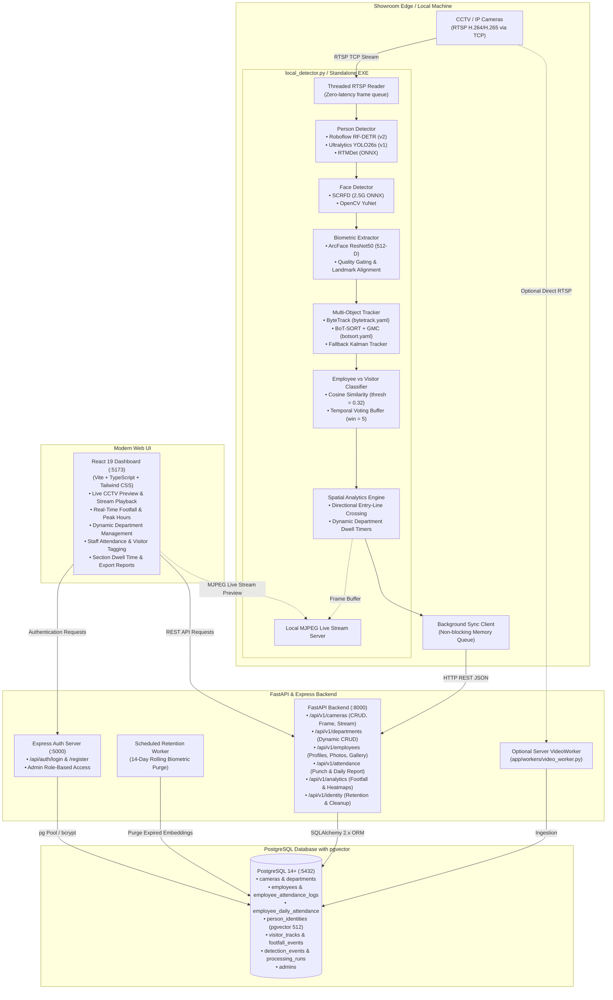
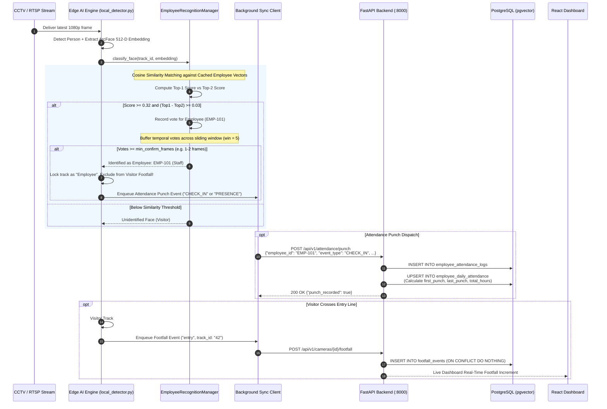
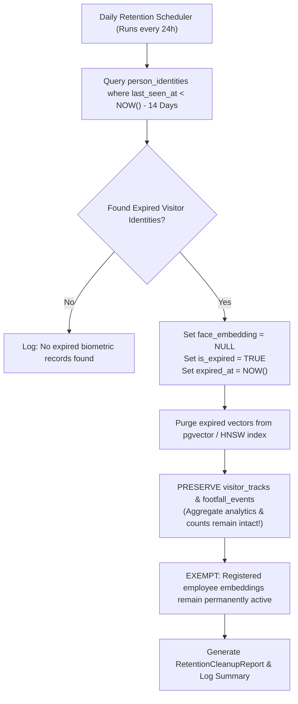
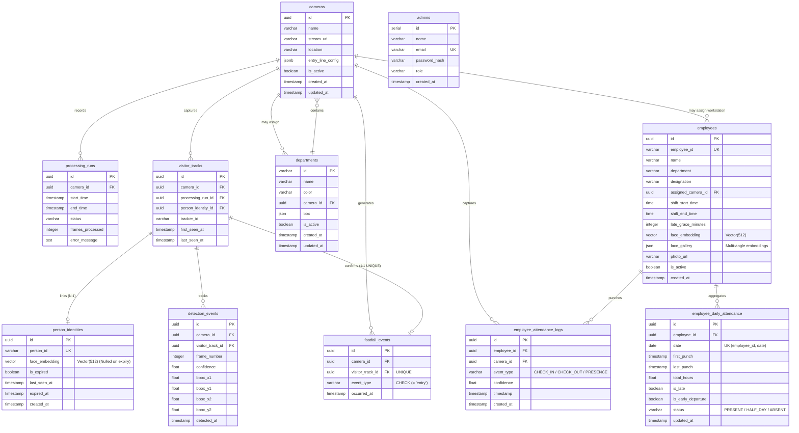

# Showroom Visitor Intelligence (JMS) — Architecture & Data Flow Specification

This document details the end-to-end system architecture, operational data flows, communication protocols, computer vision algorithms, biometric matching pipelines, and database schemas powering the **Showroom Visitor Intelligence & Footfall Analytics** platform.

---

## 1. High-Level Architecture Overview

The system is engineered as an **Edge-AI Hybrid Architecture**. Computationally intensive deep-learning inference (object detection, multi-object tracking, neural face detection, and biometric embedding extraction) runs locally at the showroom edge near the camera network. Analytics aggregation, employee management, dynamic departments, session authentication, and data retention run on a centralized backend and modern web dashboard.



---

## 2. Core Computer Vision & Biometric Pipeline

### 2.1 RTSP Stream Ingestion & Non-Blocking Draining
* **TCP Transport (`rtsp_transport;tcp`)**: UDP RTSP feeds drop packets over congested LANs, creating H.264 macroblock corruption and frozen frames. The system globally enforces TCP via OpenCV FFmpeg flags.
* **Threaded Frame Draining (`ThreadedRTSPReader`)**: Standard OpenCV `cv2.VideoCapture` maintains an internal multi-frame decode buffer. If deep inference takes 30ms, frames queue up and create massive lag. `ThreadedRTSPReader` spawns a dedicated daemon thread running `grab()` continuously, storing solely the latest decoded frame. Latency from physical camera lens to inference input is kept under **30–50ms**.

### 2.2 Multi-Model Person Detection Architecture
The edge engine supports dynamic runtime switching across detection backends:
1. **Roboflow RF-DETR (`--v2`)**: Real-Time Detection Transformer with DINOv2 self-supervised visual backbone. Delivers unmatched precision in crowded environments, eliminating false merges and detecting seated, partially occluded, or distant persons.
2. **Ultralytics YOLO (`--v1`)**: Ultra-fast convolutional detection engine (defaults to `models/yolo26s.pt`). Provides rapid inference (15–30ms per frame on modern GPUs or 50–70ms on modern multi-core CPUs).
3. **RTMDet Support**: ONNX runtime engine optimized for high-throughput edge devices.

Inference input resolution defaults to `1024x1024` pixels (`--imgsz 1024`), ensuring small faces and distant visitors entering through showroom glass doorways are detected reliably.

### 2.3 Neural Face Detection & Quality Gating
Face detection operates under a hierarchical upper-torso spatial constraint:
* **Detector Models**: SCRFD (`scrfd_2.5g_bnkps.onnx`) or OpenCV YuNet (`face_detection_yunet_2023mar.onnx`).
* **Spatial Alignment**: Face boxes are strictly validated within the top 35% of the person's bounding box. This prevents false face triggers from clothing graphics, catalog prints, or posters.
* **Biometric Quality Filters**:
  * **Face Blur Filtering**: Laplacian variance must exceed `FACE_BLUR_THRESHOLD = 5.0` to reject fast-motion blur.
  * **Head Pose Limits**: Maximum yaw $\le 65^\circ$, pitch $\le 50^\circ$, and roll $\le 40^\circ$ (specifically accommodating $35^\circ$–$45^\circ$ overhead CCTV angles).
  * **Inter-Ocular Distance**: Minimum eye distance $\ge 2.5$ pixels to reject unresolvable distant faces.
  * **Illumination Gating**: Mean grayscale illumination between 18.0 and 245.0 to filter extreme backlight silhouettes or lens glare.

### 2.4 ArcFace Biometric Feature Extraction
For validated faces:
* **Canonical 5-Point Alignment**: Faces are geometrically aligned to canonical $112 \times 112$ ArcFace reference landmarks using affine similarity transformation.
* **Deep Feature Representation**: Passing through ArcFace ResNet50 (`models/w600k_r50.onnx`) outputs a 512-dimensional feature vector.
* **L2-Normalization**: Feature vectors are L2-normalized:
  $$\mathbf{e} = \frac{\mathbf{v}}{\|\mathbf{v}\|_2}, \quad \|\mathbf{e}\|_2 = 1.0$$
* **Distance Metric**: Similarity between two face embeddings $\mathbf{e}_1, \mathbf{e}_2$ is calculated as dot-product cosine similarity:
  $$\text{CosineSimilarity}(\mathbf{e}_1, \mathbf{e}_2) = \mathbf{e}_1 \cdot \mathbf{e}_2$$

---

## 3. Employee Recognition & Automated Attendance Flow



### 3.1 Multi-Frame Voting Buffer Guarantee
To guarantee zero false positives (ensuring a visitor is never mistakenly tagged as an employee):
1. **Calibrated Threshold**: Baseline cosine similarity requires $\ge 0.32$.
2. **Top-1 vs Top-2 Match Margin**: The gap between the best match and second-best candidate from a different employee must be $\ge 0.030$.
3. **Temporal Voting Buffer**: Successive observations over `EMPLOYEE_VOTE_WINDOW` frames must vote for the same employee identity before the track is tagged as staff. Once confirmed, the employee ID is bound to that track for its duration.

### 3.2 Daily Attendance Roll Computation
When punches are ingested:
* **First Seen**: Sets `first_punch` for the day. If `first_punch > shift_start_time + late_grace_minutes`, `is_late` flag is set to `True`.
* **Last Seen**: Progressively updates `last_punch`.
* **Working Hours**: Total work duration is continuously calculated:
  $$\text{WorkDuration} = \text{last\_punch} - \text{first\_punch}$$
* **Early Departure**: If last punch is before `shift_end_time - early_departure_grace_minutes`, `is_early_departure` flag is recorded.

---

## 4. Multi-Object Tracking & Motion Stabilization

### 4.1 Pluggable Trackers
The system provides two production tracker configurations:
* **ByteTrack (`bytetrack.yaml`)**:
  - Associates both high-confidence ($> 0.20$) and low-confidence ($> 0.10$) detection boxes across frames.
  - Maintains lost tracks for up to `track_buffer: 150` frames (~5–7 seconds), bridging temporary occlusions when visitors walk behind showroom display cases or pillars.
* **BoT-SORT (`botsort.yaml`)**:
  - Extends tracking with **Global Motion Compensation (GMC)** via sparse optical flow (`sparseOptFlow`).
  - Mitigates false track drift caused by camera pole vibration, wind sway, or manual PTZ adjustments.
  - Tracks direct bounding box width and height states $(x, y, w, h)$ for improved tracking across seated-to-standing posture shifts.

### 4.2 Track Smoothing & Jitter Deadband
Raw detections exhibit coordinate micro-jitter due to digital sensor noise. The edge engine applies:
* **Exponential Moving Average (EMA)** smoothing:
  $$\text{Box}_{t} = \alpha \cdot \text{Box}_{\text{detected}} + (1 - \alpha) \cdot \text{Box}_{t-1}, \quad \text{with } \alpha = 0.35$$
* **Stationary Deadband Filter**: Shifts smaller than `deadband = 6.0` pixels are suppressed, locking bounding boxes motionless when persons stand still.

---

## 5. Virtual Entry-Line Crossing & Spatial Departments

### 5.1 Ground-Plane Contact Calculation
To eliminate false triggers from head bobbing or gestures, line crossings are computed solely from the **bottom-center ground contact point**:
$$\text{Point}_{\text{feet}} = \left( \frac{x_1 + x_2}{2}, \; y_2 \right)$$

### 5.2 2D Intersection Geometry
A track moving from position $A(x_A, y_A)$ to $B(x_B, y_B)$ crosses calibrated line segment $P_1(x_1, y_1) \to P_2(x_2, y_2)$ if:
1. Segments $AB$ and $P_1P_2$ intersect (tested via orientation cross products):
   $$\text{ccw}(A, B, C) = (C_y - A_y) \cdot (B_x - A_x) > (B_y - A_y) \cdot (C_x - A_x)$$
2. Vector $A \to B$ matches the configured direction (`top_to_bottom`, `bottom_to_top`, `left_to_right`, or `right_to_left`).

### 5.3 Multi-Tier Duplicate Prevention
Double counting is strictly prevented at two architectural tiers:
* **Tier 1 (In-Memory)**: Edge engine maintains `counted_track_ids: Set[str]`. Once crossed, the tracker ID is permanently locked.
* **Tier 2 (PostgreSQL)**: The `footfall_events` table enforces `UNIQUE(visitor_track_id)`. Duplicate requests return HTTP 200 without inserting duplicate rows.

### 5.4 Dynamic Department Zones & Dwell Time
Showroom departments (e.g. Diamond, Gold, Luxury Lounge) are configured as 2D polygonal bounding boxes:
* Each track's foot reference point is evaluated against the zone polygon.
* Ingress triggers department entry; continuous presence accumulates dwell duration.
* If a tracked person is identified as staff, their presence is excluded from customer dwell metrics.

---

## 6. Biometric Privacy & 14-Day Rolling Retention

To comply with data privacy regulations (GDPR and privacy principles):



* **Visitor Biometric Isolation**: Face embeddings extracted from unidentified visitors are assigned an automatic 14-day rolling expiration window.
* **Permanent Employee Exemption**: Registered staff embeddings stored in the `employees` table are permanent and exempt from the purge.
* **Analytics Preservation**: Historical footfall counts, peak-hour distributions, and dwell durations remain fully intact when biometric embeddings are purged.

---

## 7. Relational Database Schema (PostgreSQL + pgvector)



---

## 8. Summary: End-to-End Ingress Lifecycle

```
[ Visitor / Staff steps through Showroom Entrance ]
                        │
                        ▼
           [ CCTV RTSP TCP Stream ]
                        │
                        ▼
      [ ThreadedRTSPReader (Zero Lag Frame Grab) ]
                        │
                        ▼
       [ Roboflow RF-DETR / YOLO Person Detection ]
                        │
                        ▼
       [ SCRFD / YuNet Face Detection + Quality Gating ]
                        │
                        ▼
    [ ArcFace 512-D L2 Normalized Embedding Extraction ]
                        │
                        ▼
  [ Cosine Similarity Matching vs Registered Staff Gallery ]
       │                                       │
       │ (Match >= 0.32 + Voting Lock)         │ (Unmatched / Visitor)
       ▼                                       ▼
[ Identified as Employee ]             [ Tracked as Showroom Visitor ]
       │                                       │
       ├─► Exclude from footfall counts        ├─► Multi-object tracking (ByteTrack / BoT-SORT)
       ├─► Log Attendance Punch (CHECK_IN)     ├─► Ground-plane feet reference point calculation
       └─► Upsert Daily Attendance Roll        ├─► Directional line crossing verification
                                               ├─► In-memory deduplication lock
                                               ├─► Non-blocking HTTP POST to /footfall
                                               ├─► PostgreSQL UNIQUE constraint validation
                                               └─► Real-Time React 19 Dashboard UI updates
```
